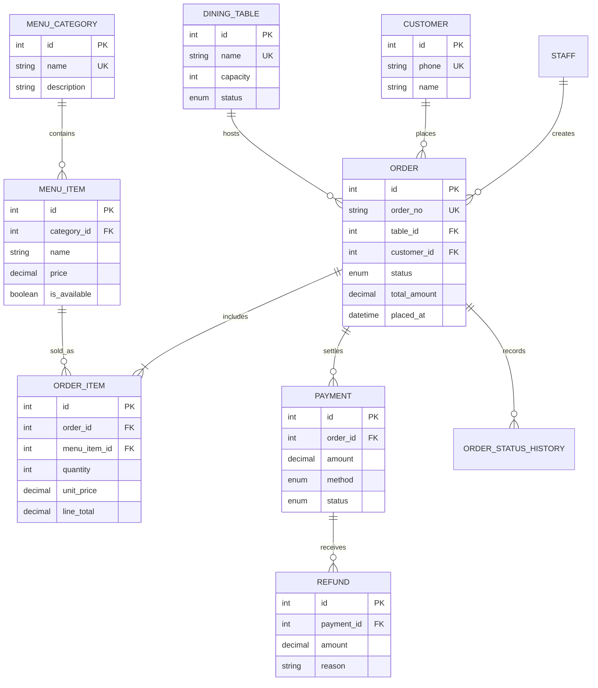

# Database Design

## Entity-Relationship Overview



## Normalization

The operational schema is designed for 3NF:

- Menu categories and menu items are separate entities.
- Current menu price is stored only in `menu_items`.
- Historical purchase price is stored in `order_items`, because it describes the transaction rather than the current menu.
- Orders contain no repeating item columns.
- Payment and refund records are separated by event and do not duplicate order totals.
- Customer, table, and staff identifiers are referenced by keys instead of repeated descriptive fields.

## State Model

```text
open -> paid -> partially_refunded -> refunded
  |
  +-> cancelled
```

The first implementation supports `open`, `paid`, `partially_refunded`, and `refunded`. The enum also reserves `cancelled`, which can be implemented in a later increment.

## Important Integrity Decisions

- A dining table can have only one open order because opening an order changes table status to `occupied`.
- An order cannot add items after checkout.
- Menu prices cannot be negative.
- Order-item quantities must be positive.
- Refund amounts cannot exceed the remaining payment amount.
- Historical order items keep their original unit price and line total.
- Financial events are append-only; refunding does not delete payment or order history.

## Transaction Boundaries

### Open Order

1. Lock the dining-table row with `SELECT ... FOR UPDATE`.
2. Verify that its status is `available`.
3. Create the order and initial status-history row.
4. Mark the table `occupied`.
5. Commit atomically.

### Add Item

1. Lock and validate the open order.
2. Verify menu availability.
3. Insert or update the order item using the current menu price.
4. Commit atomically.

### Checkout

1. Lock the open order and its items.
2. Recalculate the total from order-item snapshots.
3. Insert the payment.
4. Mark the order paid and timestamp closure.
5. Release the dining table.
6. Commit all changes atomically.

### Refund

1. Lock the paid order and payment history.
2. Validate the requested refund against the remaining paid amount.
3. Append the refund.
4. Update payment and order status.
5. Commit atomically.

## Indexing Strategy

Initial indexes:

- `orders(status, placed_at)` for sales and time-window analytics.
- `order_items(menu_item_id)` for menu performance.
- `payments(order_id)` for payment/refund resolution.
- `menu_items(category_id, is_available)` for menu queries.
- Unique keys for `orders.order_no`, `customers.phone`, and `dining_tables.name`.

Week 3 will evaluate the actual query plans and replace speculative indexes with measured choices.

